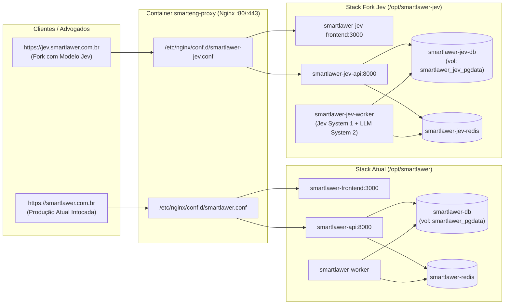

# SmartLawer_V2 (Fork Jev) — Plano de Implementação DeepCode (`jev.smartlawer.com.br`)

> **For agentic workers / LLMs:** REQUIRED SUB-SKILL: Use `superpowers:subagent-driven-development` (recommended) or `superpowers:executing-plans` to implement this plan task-by-task. Steps use checkbox (`- [ ]`) syntax for tracking. Every phase includes a dedicated **`/goal` DeepCode prompt** and ends with a mandatory **`git commit`**.

**Goal:** Implementar um fork isolado do SmartLawer_V2 (acessível em `https://jev.smartlawer.com.br`, sem qualquer conflito de containers, banco de dados, volumes ou portas com a versão atual em `https://smartlawer.com.br`) integrando o modelo **Jev** (*System One Model* da TypeSafe AI) em 8 pontos críticos do backend para reduzir custos de LLM em ~60%, eliminar heurísticas frágeis de substring e elevar a assertividade epistêmica do Dossiê Jurídico Universal V3.

**Architecture:** Arquitetura híbrida **System 1 (Jev) + System 2 (LLM) + Motor Determinístico (Python Decimal)**. O Jev (`POST https://api.typesafe.ai/v1/systemone`, primitivas `noul`, `choice`, `score`) atua como classificador multirrótulo, filtro pré-extração de lotes, reconciliador de controvérsias, avaliador semântico das matrizes dos 10 módulos especializados, auditor epistêmico de fontes (`verification_status`), reranker de RAG e guardrail de *prompt injection*/LGPD. Quando `JEV_ENABLED=False` ou sem chave, todo ponto degrada de forma transparente e determinística para o comportamento atual, preservando 100% dos testes legados.

**Tech Stack:** Python 3.11+, FastAPI, Pydantic v2, SQLAlchemy 2.x, Alembic, Celery, Redis 7, PostgreSQL 15 + `pgvector`, `httpx`, `pytest`, Next.js, React, TypeScript, Docker Compose, Nginx + Certbot (Let's Encrypt).

**Spec de Referência:** `docs/superpowers/specs/2026-11-01-jev-system-one-integration-analysis.md`

---

## Global Constraints (Invariantes Inegociáveis para a LLM Executora)

1. **Isolamento Total de Produção (`smartlawer.com.br` vs `jev.smartlawer.com.br`):** Nenhum container (`smartlawer-*`), volume (`smartlawer_pgdata`, `smartlawer_redisdata`, `smartlawer_uploads`) ou configuração Nginx (`smartlawer.conf`) da produção atual pode ser sobrescrito. A stack Jev roda em diretório separado (`/opt/smartlawer-jev`), com `docker-compose.jev.yml`, containers `smartlawer-jev-*`, volumes `smartlawer_jev_*` e vhost Nginx `smartlawer-jev.conf` respondendo exclusivamente por `jev.smartlawer.com.br`.
2. **Invariantes do Schema 3.0 (`AC-01` a `AC-12`):** `coerce_legacy_analysis()` nunca é chamada no caminho V3. Toda seção tem `SectionState` com `reason` não vazio. Nenhuma tese genérica (`_BANNED_GENERIC_FRAGMENTS`) é admitida.
3. **Alegação $\neq$ Prova (`AC-02`):** Fatos alegados unilateralmente sem prova examinada nunca recebem `epistemic_status = "documented"`.
4. **Proibição de Aritmética Livre por IA (`AC-08`):** Valores monetários usam sempre `Decimal` em `backend/app/core/calculations.py`; o Jev jamais calcula valores finais.
5. **Fallback Seguro e Zero Regressão:** Com `JEV_ENABLED=False` (default inicial no código para não quebrar testes offline sem chave), todos os testes existentes em `backend/tests/` devem passar sem necessidade de rede externa.
6. **Privacidade e Logs Seguros:** Logs e envelopes de erro nunca expõem texto da petição, CPF/CNPJ sem máscara (`mask_pii`), prompts ou chaves de API (`TYPESAFE_API_KEY`).
7. **Disciplina de Commits por Fase:** É estritamente proibido avançar da Fase $N$ para a Fase $N+1$ sem antes: (a) rodar os testes automatizados da fase; (b) confirmar `PASS` com código de saída `0`; e (c) realizar o `git commit` atômico da fase no fork/branch `fork/jev-system-one`.

---

## Arquitetura de Isolamento de Deploy (Produção Atual vs. Fork Jev)



---

## Proposed Changes (Mapa de Arquivos do Plano)

### Infraestrutura de Fork e Subdomínio (Novos / Modificados)
- `[NEW]` `docker-compose.jev.yml`: Stack de produção isolada para o fork Jev (`smartlawer-jev-*`).
- `[NEW]` `enable-ssl-jev.sh`: Script de provisionamento Let's Encrypt e configuração Nginx (`smartlawer-jev.conf`) exclusiva para `jev.smartlawer.com.br`.
- `[MODIFY]` `.env.example`: Documentação das variáveis `JEV_*`, `TYPESAFE_API_KEY` e `NEXT_PUBLIC_APP_ENV`.

### Backend Core & Módulos (Novos / Modificados)
- `[MODIFY]` `backend/app/core/config.py`: Adição das flags e limiares `JEV_*`.
- `[NEW]` `backend/app/core/jev_provider.py`: Cliente `JevSystemOneProvider` (`noul`, `choice`, `score`) + `JevUnavailableError` + helper `get_jev_provider()`.
- `[MODIFY]` `backend/app/core/classification.py`: Classificação multirrótulo, tipo documental, rito e fase via Jev com fallback para `_AREA_KEYWORDS`.
- `[MODIFY]` `backend/app/core/structured_extractor.py`: Correção do truncamento `block_text[:4000]` $\rightarrow$ `max_chars` configurável e função `should_extract_batch(batch, jev_provider=None)`.
- `[MODIFY]` `backend/app/core/pipeline/orchestrator.py`: Integração do *Pre-Extraction Gate*, auditoria epistêmica de fontes (`audit_sources_and_facts_with_jev`) e telemetria `skipped_boilerplate_batches`.
- `[MODIFY]` `backend/app/core/reconciler.py`: Deduplicação semântica de fatos sobrepostos e geração de `controversies` factuais entre polos com Jev.
- `[NEW]` `backend/app/core/jev_module_evaluator.py`: Avaliador semântico em lote único das matrizes dos 10 módulos especializados via Jev.
- `[MODIFY]` `backend/app/core/module_runner.py` e `backend/app/modules/corporate/module.py`: Correção do bug `"deferi"` em `"indeferiu"` e enriquecimento das `issue_assessments` via `jev_module_evaluator`.
- `[MODIFY]` `backend/app/tasks/document_tasks.py`: Eliminação da chamada LLM V1 duplicada quando `DOSSIER_V3_ENABLED=True` por meio de `project_v3_to_legacy_analysis`.
- `[MODIFY]` `backend/app/core/security_rag.py`, `backend/app/core/retrieval.py` e `backend/app/core/rag_answer.py`: Classificação probabilística de *prompt injection* (`screen_query_security` com `caution=True`), detecção semântica de inventário global e reranking/abstenção calibrada com Jev.
- `[MODIFY]` `backend/app/core/visual_evidence.py` e `backend/app/core/eval_scoring.py`: Classificação de `VisualKind` e sensibilidade LGPD (`hidden_by_default=True`) + juiz semântico opcional no gate de avaliação.

### Suíte de Testes (Novos / Modificados)
- `[NEW]` `backend/tests/test_jev_infra_isolation.py`
- `[NEW]` `backend/tests/test_jev_provider.py`
- `[NEW]` `backend/tests/test_jev_module_evaluator.py`
- `[MODIFY]` `backend/tests/test_dossier_classification.py`
- `[MODIFY]` `backend/tests/test_structured_extractor.py`
- `[MODIFY]` `backend/tests/test_dossier_reconciler.py`
- `[MODIFY]` `backend/tests/test_dossier_verifier.py`
- `[MODIFY]` `backend/tests/test_corporate_module.py`
- `[MODIFY]` `backend/tests/test_real_stages.py`
- `[MODIFY]` `backend/tests/test_security_rag.py`
- `[MODIFY]` `backend/tests/test_retrieval.py`
- `[MODIFY]` `backend/tests/test_visual_evidence.py`
- `[MODIFY]` `backend/tests/test_eval_gate.py`

---

## Fases de Execução no Método DeepCode (`/goal` + TDD + Git Commit)

---

### Fase 0: Criação do Fork Isolado, Stack Docker Paralela e Subdomínio `jev.smartlawer.com.br`

#### Comando `/goal` (Método DeepCode — Fase 0)
```text
/goal [DeepCode Fase 0] Isolar a implementação do modelo Jev em uma branch/fork dedicada (`fork/jev-system-one`) e criar toda a infraestrutura de deploy paralelo (`docker-compose.jev.yml` e `enable-ssl-jev.sh`) para o subdomínio `jev.smartlawer.com.br`, garantindo que containers (`smartlawer-jev-*`), volumes (`smartlawer_jev_*`), banco de dados e configuração Nginx (`smartlawer-jev.conf`) jamais conflitem com a versão de produção atual (`smartlawer.com.br`). Validar sintaxe dos arquivos e realizar o commit inicial da fase.
```

**Files:**
- Create: `docker-compose.jev.yml`
- Create: `enable-ssl-jev.sh`
- Modify: `.env.example`
- Test: `backend/tests/test_jev_infra_isolation.py`

**Interfaces:**
- Consumes: `docker-compose.prod.yml`, `enable-ssl.sh`.
- Produces: Stack isolada `smartlawer-jev-*` na rede `smartlawer_network` e vhost Nginx para `jev.smartlawer.com.br`.

- [ ] **Step 1: Criar e mudar para a branch do fork isolado (`fork/jev-system-one`)**

```bash
git checkout -b fork/jev-system-one
```

- [ ] **Step 2: Escrever o teste de isolamento da infraestrutura Jev (`Red`)**

Criar `backend/tests/test_jev_infra_isolation.py`:
```python
from pathlib import Path
import yaml


ROOT = Path(__file__).resolve().parents[2]


def test_jev_compose_uses_isolated_containers_and_volumes():
    compose_path = ROOT / "docker-compose.jev.yml"
    assert compose_path.exists(), "docker-compose.jev.yml deve existir"
    data = yaml.safe_load(compose_path.read_text(encoding="utf-8"))
    services = data.get("services") or {}
    expected_containers = {
        "db": "smartlawer-jev-db",
        "redis": "smartlawer-jev-redis",
        "api": "smartlawer-jev-api",
        "worker": "smartlawer-jev-worker",
        "frontend": "smartlawer-jev-frontend",
    }
    for svc, container_name in expected_containers.items():
        assert services[svc]["container_name"] == container_name

    volumes = set((data.get("volumes") or {}).keys())
    assert volumes == {
        "smartlawer_jev_pgdata",
        "smartlawer_jev_redisdata",
        "smartlawer_jev_uploads",
    }


def test_enable_ssl_jev_targets_isolated_subdomain_and_nginx_conf():
    script_path = ROOT / "enable-ssl-jev.sh"
    assert script_path.exists(), "enable-ssl-jev.sh deve existir"
    content = script_path.read_text(encoding="utf-8")
    assert 'DOMAIN="jev.smartlawer.com.br"' in content
    assert "smartlawer-jev.conf" in content
    assert "http://smartlawer-jev-api:8000" in content
    assert "http://smartlawer-jev-frontend:3000" in content
    assert "/etc/nginx/conf.d/smartlawer.conf" not in content
```

- [ ] **Step 3: Executar o teste e confirmar a falha (`Red`)**

Run: `cd backend && python -m pytest tests/test_jev_infra_isolation.py -q`
Expected: `FAIL` (`docker-compose.jev.yml deve existir`).

- [ ] **Step 4: Implementar `docker-compose.jev.yml`, `enable-ssl-jev.sh` e atualizar `.env.example` (`Green`)**

Criar `docker-compose.jev.yml`:
```yaml
# SmartLawer V2 (Fork Jev System One) - Isolated Production Docker Compose
# Subdomain: https://jev.smartlawer.com.br
# Zero collision with main production containers/volumes on smartlawer.com.br

services:
  db:
    restart: unless-stopped
    image: pgvector/pgvector:pg15
    container_name: smartlawer-jev-db
    environment:
      - POSTGRES_USER=${POSTGRES_USER:-postgres}
      - POSTGRES_PASSWORD=${POSTGRES_PASSWORD}
      - POSTGRES_DB=${POSTGRES_DB:-smartlawer_jev}
    volumes:
      - smartlawer_jev_pgdata:/var/lib/postgresql/data
    healthcheck:
      test: ["CMD-SHELL", "pg_isready -U ${POSTGRES_USER:-postgres} -d ${POSTGRES_DB:-smartlawer_jev}"]
      interval: 5s
      timeout: 5s
      retries: 5
    networks:
      - smartlawer_network

  redis:
    restart: unless-stopped
    image: redis:7-alpine
    container_name: smartlawer-jev-redis
    volumes:
      - smartlawer_jev_redisdata:/data
    healthcheck:
      test: ["CMD", "redis-cli", "ping"]
      interval: 5s
      timeout: 5s
      retries: 5
    networks:
      - smartlawer_network

  api:
    restart: unless-stopped
    build:
      context: ./backend
      dockerfile: Dockerfile
    container_name: smartlawer-jev-api
    command: uvicorn app.main:app --host 0.0.0.0 --port 8000
    env_file:
      - .env
    environment:
      - DATABASE_URL=postgresql://${POSTGRES_USER:-postgres}:${POSTGRES_PASSWORD}@smartlawer-jev-db:5432/${POSTGRES_DB:-smartlawer_jev}
      - REDIS_URL=redis://smartlawer-jev-redis:6379/0
      - ENVIRONMENT=production
      - JEV_ENABLED=${JEV_ENABLED:-true}
    volumes:
      - smartlawer_jev_uploads:/data/uploads
    healthcheck:
      test:
        [
          "CMD-SHELL",
          "python -c \"import urllib.request; urllib.request.urlopen('http://localhost:8000/health')\"",
        ]
      interval: 10s
      timeout: 5s
      retries: 5
      start_period: 30s
    depends_on:
      db:
        condition: service_healthy
      redis:
        condition: service_healthy
    networks:
      - smartlawer_network

  worker:
    restart: unless-stopped
    build:
      context: ./backend
      dockerfile: Dockerfile
    container_name: smartlawer-jev-worker
    command: celery -A app.worker:celery_app worker --loglevel=info --concurrency=2
    env_file:
      - .env
    environment:
      - DATABASE_URL=postgresql://${POSTGRES_USER:-postgres}:${POSTGRES_PASSWORD}@smartlawer-jev-db:5432/${POSTGRES_DB:-smartlawer_jev}
      - REDIS_URL=redis://smartlawer-jev-redis:6379/0
      - ENVIRONMENT=production
      - JEV_ENABLED=${JEV_ENABLED:-true}
    volumes:
      - smartlawer_jev_uploads:/data/uploads
    depends_on:
      api:
        condition: service_healthy
      db:
        condition: service_healthy
      redis:
        condition: service_healthy
    networks:
      - smartlawer_network

  frontend:
    restart: unless-stopped
    build:
      context: .
      dockerfile: frontend.Dockerfile
    container_name: smartlawer-jev-frontend
    environment:
      - NODE_ENV=production
      - PORT=3000
      - NEXT_PUBLIC_APP_VARIANT=jev
    depends_on:
      api:
        condition: service_healthy
    networks:
      - smartlawer_network

networks:
  smartlawer_network:
    external: true
    name: smartlawer_network

volumes:
  smartlawer_jev_pgdata:
  smartlawer_jev_redisdata:
  smartlawer_jev_uploads:
```

Criar `enable-ssl-jev.sh`:
```bash
#!/usr/bin/env bash
set -e

DOMAIN="jev.smartlawer.com.br"
EMAIL="sergioschina@hotmail.com"
WEBROOT="/srv/certbot/www"

echo "========================================================="
echo "  Ativacao de SSL HTTPS - SmartLawer V2 (Fork Modelo Jev)"
echo "  Subdominio isolado: https://$DOMAIN"
echo "========================================================="

echo "[1/4] Verificando propagacao DNS para $DOMAIN..."
RESOLVED_IP=$(python3 -c "import socket; print(socket.gethostbyname('$DOMAIN'))" 2>/dev/null || echo "not_resolved")

if [ "$RESOLVED_IP" != "164.152.35.112" ]; then
    echo "AVISO: $DOMAIN aponta para '$RESOLVED_IP' (esperado: 164.152.35.112)."
    echo "Crie um registro A para 'jev' no Registro.br apontando para 164.152.35.112."
    read -r -p "Deseja forcar a tentativa mesmo assim? (s/N) " resp
    if [[ ! "$resp" =~ ^[sSyY]$ ]]; then
        exit 1
    fi
fi

echo "[2/4] Solicitando certificado Let's Encrypt para $DOMAIN..."
sudo certbot certonly --webroot -w "$WEBROOT" \
    -d "$DOMAIN" \
    --agree-tos --non-interactive \
    --email "$EMAIL"

echo "[3/4] Gerando configuracao Nginx isolada (nginx-smartlawer-jev.conf)..."
cat << 'NGINX_EOF' | sudo tee /opt/smarteng/deploy/nginx-smartlawer-jev.conf > /dev/null
server {
    listen 80;
    server_name jev.smartlawer.com.br;

    location ^~ /.well-known/acme-challenge/ {
        root /srv/certbot/www;
    }

    location / {
        return 301 https://$host$request_uri;
    }
}

server {
    listen 443 ssl;
    server_name jev.smartlawer.com.br;

    ssl_certificate /etc/letsencrypt/live/jev.smartlawer.com.br/fullchain.pem;
    ssl_certificate_key /etc/letsencrypt/live/jev.smartlawer.com.br/privkey.pem;
    include /etc/letsencrypt/options-ssl-nginx.conf;
    ssl_dhparam /etc/letsencrypt/ssl-dhparams.pem;

    add_header Strict-Transport-Security "max-age=63072000" always;
    add_header X-SmartLawer-Variant "jev-system-one" always;

    location ^~ /.well-known/acme-challenge/ {
        root /srv/certbot/www;
    }

    location /api/ {
        proxy_pass http://smartlawer-jev-api:8000;
        proxy_http_version 1.1;
        proxy_set_header Host $host;
        proxy_set_header X-Real-IP $remote_addr;
        proxy_set_header X-Forwarded-For $proxy_add_x_forwarded_for;
        proxy_set_header X-Forwarded-Proto $scheme;
        client_max_body_size 50M;
        proxy_read_timeout 300s;
        proxy_connect_timeout 300s;
    }

    location = /health {
        proxy_pass http://smartlawer-jev-api:8000/health;
        proxy_set_header Host $host;
    }

    location / {
        proxy_pass http://smartlawer-jev-frontend:3000;
        proxy_http_version 1.1;
        proxy_set_header Upgrade $http_upgrade;
        proxy_set_header Connection "upgrade";
        proxy_set_header Host $host;
        proxy_set_header X-Real-IP $remote_addr;
        proxy_set_header X-Forwarded-For $proxy_add_x_forwarded_for;
        proxy_set_header X-Forwarded-Proto $scheme;
    }
}
NGINX_EOF

echo "[4/4] Copiando para smarteng-proxy sem tocar em smartlawer.conf..."
sudo docker cp /opt/smarteng/deploy/nginx-smartlawer-jev.conf smarteng-proxy:/etc/nginx/conf.d/smartlawer-jev.conf
sudo docker exec smarteng-proxy nginx -t
sudo docker exec smarteng-proxy nginx -s reload

echo "========================================================="
echo "  Subdominio Jev ativo em https://$DOMAIN !"
echo "========================================================="
```

- [ ] **Step 5: Executar os testes da Fase 0 e fazer o Commit Obrigatório**

Run: `cd backend && python -m pytest tests/test_jev_infra_isolation.py -q`
Expected: `2 passed`.

```bash
git add docker-compose.jev.yml enable-ssl-jev.sh .env.example backend/tests/test_jev_infra_isolation.py
git commit -m "chore(infra): isolate Jev fork stack and jev.smartlawer.com.br subdomain"
```

---

### Fase 1: Fundação `JevSystemOneProvider` e Configurações (`jev_provider.py` + `config.py`)

#### Comando `/goal` (Método DeepCode — Fase 1)
```text
/goal [DeepCode Fase 1] Implementar o cliente tipado `JevSystemOneProvider` (`backend/app/core/jev_provider.py`) para a API System One da TypeSafe AI (`POST /v1/systemone`) suportando as primitivas `noul`, `choice` e `score` em passagem paralela, adicionar as variáveis de configuração `JEV_*` em `backend/app/core/config.py` (incluindo `https://jev.smartlawer.com.br` em `CORS_ORIGINS`), garantir tratamento seguro de indisponibilidade (`JevUnavailableError`) e validar com 100% de cobertura unitária em `backend/tests/test_jev_provider.py`, finalizando com commit atômico.
```

**Files:**
- Modify: `backend/app/core/config.py`
- Create: `backend/app/core/jev_provider.py`
- Create: `backend/tests/test_jev_provider.py`
- Test: `backend/tests/test_jev_provider.py`

**Interfaces:**
- Consumes: `app.core.config.settings`, `httpx`.
- Produces: `JevSystemOneProvider`, `JevUnavailableError`, `SystemOneProvider`, `get_jev_provider() -> JevSystemOneProvider`.

- [ ] **Step 1: Escrever os testes unitários falhos para `jev_provider.py` (`Red`)**

Criar `backend/tests/test_jev_provider.py`:
```python
import httpx
import pytest

from app.core.config import settings
from app.core.jev_provider import (
    JevSystemOneProvider,
    JevUnavailableError,
    get_jev_provider,
)


def test_jev_provider_disabled_by_default(monkeypatch):
    monkeypatch.setattr(settings, "JEV_ENABLED", False)
    monkeypatch.setattr(settings, "TYPESAFE_API_KEY", "ts-key-123")
    provider = get_jev_provider()
    assert provider.is_configured() is False
    with pytest.raises(JevUnavailableError):
        provider.evaluate("estado", {"q1": {"type": "noul", "instructions": "teste?"}})


def test_jev_provider_evaluates_noul_choice_and_score_in_parallel(monkeypatch):
    monkeypatch.setattr(settings, "JEV_ENABLED", True)
    captured_payload = {}

    def handler(request: httpx.Request) -> httpx.Response:
        assert request.headers["Authorization"] == "Bearer ts-secret"
        import json

        captured_payload.update(json.loads(request.content.decode("utf-8")))
        return httpx.Response(
            200,
            json={
                "model": "jev-1.13.0",
                "answers": {
                    "is_urgent": {"type": "noul", "noul": 0.92},
                    "area": {"type": "choice", "choice": "labor"},
                    "support_level": {"type": "score", "score": 3.5},
                },
                "usage": {"input_tokens": 120, "output_tokens": 0},
            },
        )

    client = httpx.Client(transport=httpx.MockTransport(handler))
    provider = JevSystemOneProvider(
        api_key="ts-secret",
        base_url="https://api.typesafe.ai/v1/systemone",
        model="jev-latest",
        http_client=client,
    )
    assert provider.is_configured() is True
    result = provider.evaluate(
        "Reclamação trabalhista com pedido liminar.",
        {
            "is_urgent": {"type": "noul", "instructions": "Há pedido urgente?"},
            "area": {
                "type": "choice",
                "instructions": "Qual a área?",
                "options": ["labor", "civil_procedure", "general"],
            },
            "support_level": {
                "type": "score",
                "instructions": "Grau de suporte?",
                "min": 0,
                "max": 4,
            },
        },
    )
    assert captured_payload["model"] == "jev-latest"
    assert result["is_urgent"] == pytest.approx(0.92)
    assert result["area"] == "labor"
    assert result["support_level"] == pytest.approx(3.5)
    assert result["_usage"]["input_tokens"] == 120


def test_jev_provider_wraps_http_error_into_unavailable(monkeypatch):
    monkeypatch.setattr(settings, "JEV_ENABLED", True)
    client = httpx.Client(
        transport=httpx.MockTransport(lambda req: httpx.Response(503, text="unavailable"))
    )
    provider = JevSystemOneProvider(api_key="ts-secret", http_client=client)
    with pytest.raises(JevUnavailableError):
        provider.evaluate("estado", {"q1": {"type": "noul", "instructions": "ok?"}})
```

- [ ] **Step 2: Executar os testes e confirmar a falha (`Red`)**

Run: `cd backend && python -m pytest tests/test_jev_provider.py -q`
Expected: `FAIL` (`ModuleNotFoundError: No module named 'app.core.jev_provider'`).

- [ ] **Step 3: Implementar as configurações em `backend/app/core/config.py` e o módulo `backend/app/core/jev_provider.py` (`Green`)**

Em `backend/app/core/config.py`, atualizar `CORS_ORIGINS` e adicionar configurações `JEV_*`:
```python
    CORS_ORIGINS: str = (
        "http://localhost:3000,http://localhost:3001,"
        "http://127.0.0.1:3000,http://127.0.0.1:3001,"
        "https://smartlawer.com.br,https://www.smartlawer.com.br,"
        "https://jev.smartlawer.com.br"
    )
    # Integração System One (TypeSafe AI - Modelo Jev)
    JEV_ENABLED: bool = False
    TYPESAFE_API_KEY: str = ""
    JEV_BASE_URL: str = "https://api.typesafe.ai/v1/systemone"
    JEV_MODEL: str = "jev-latest"
    JEV_TIMEOUT_SECONDS: float = 6.0
    JEV_BATCH_SKIP_BOILERPLATE_MIN: float = 0.85
    JEV_BATCH_CONTENT_MIN: float = 0.15
    JEV_INJECTION_BLOCK_MIN: float = 0.80
    JEV_INJECTION_CAUTION_MIN: float = 0.35
    JEV_RERANK_MIN_SCORE: float = 2.0
    JEV_LGPD_SENSITIVITY_MIN: float = 0.30
```

Criar `backend/app/core/jev_provider.py` com a implementação completa de `JevSystemOneProvider`, `JevUnavailableError` e `get_jev_provider()`.

- [ ] **Step 4: Executar os testes e verificar aprovação (`Green`)**

Run: `cd backend && python -m pytest tests/test_jev_provider.py tests/test_llm_providers.py -q`
Expected: `PASS`.

- [ ] **Step 5: Commit Obrigatório da Fase 1**

```bash
git add backend/app/core/config.py backend/app/core/jev_provider.py backend/tests/test_jev_provider.py
git commit -m "feat(core): add JevSystemOneProvider client and JEV_* settings"
```

---

### Fase 2: Classificação Jurídica Multirrótulo Calibrada com Jev (`classification.py`)

#### Comando `/goal` (Método DeepCode — Fase 2)
```text
/goal [DeepCode Fase 2] Integrar o `JevSystemOneProvider` em `backend/app/core/classification.py::classify_blocks` para realizar classificação multirrótulo semântica (área primária, áreas correlatas por probabilidade calibrada `noul >= 0.35`, tipo documental completo, rito e fase processual), preservando prioridade absoluta de `area_overrides` humanos e mantendo o classificador determinístico por keywords como fallback automático. Validar com testes unitários em `backend/tests/test_dossier_classification.py` e realizar commit.
```

**Files:**
- Modify: `backend/app/core/classification.py`
- Modify: `backend/tests/test_dossier_classification.py`
- Test: `backend/tests/test_dossier_classification.py`

**Interfaces:**
- Consumes: `JevSystemOneProvider`, `JevUnavailableError`.
- Produces: `classify_blocks(blocks: list[dict], *, area_overrides: list[str] | None = None, jev_provider=None) -> ClassificationResult`.

- [ ] **Step 1: Escrever testes falhos para classificação semântica com Jev (`Red`)**

Adicionar em `backend/tests/test_dossier_classification.py`:
```python
class _FakeJevClassifier:
    def is_configured(self) -> bool:
        return True

    def evaluate(self, state: str, questions: dict) -> dict:
        return {
            "primary_area": "labor",
            "primary_confidence": 0.91,
            "area_labor": 0.94,
            "area_social_security": 0.68,
            "area_civil_procedure": 0.42,
            "area_contracts": 0.12,
            "document_type": "peticao_inicial",
            "procedure": "procedimento comum",
            "phase": "postulatoria",
        }


def test_classify_blocks_uses_jev_calibrated_multilabel_and_phase():
    blocks = [{"normalized_text": "O obreiro sofreu infortúnio em serviço pleiteando pensão e auxílio acidentário."}]
    result = classify_blocks(blocks, jev_provider=_FakeJevClassifier())
    assert result.primary_area == "labor"
    assert "social_security" in result.related_areas
    assert "civil_procedure" in result.related_areas
    assert "contracts" not in result.related_areas
    assert result.document_types == ["peticao_inicial"]
    assert result.procedure == "procedimento comum"
    assert result.phase == "postulatoria"
    assert result.confidence == 0.91
    assert result.source == "model"
```

- [ ] **Step 2: Executar os testes e confirmar a falha (`Red`)**

Run: `cd backend && python -m pytest tests/test_dossier_classification.py -q`
Expected: `FAIL` (`TypeError: classify_blocks() got an unexpected keyword argument 'jev_provider'`).

- [ ] **Step 3: Implementar a classificação com Jev + Fallback em `backend/app/core/classification.py` (`Green`)**

Atualizar `classify_blocks` em `backend/app/core/classification.py` para aceitar `jev_provider=None`, consultar `jev_provider` (ou `get_jev_provider()`) quando configurado, construir as perguntas `primary_area` (`choice`), `primary_confidence` (`noul`), `area_<id>` (`noul`), `document_type` (`choice`), `procedure` (`choice`) e `phase` (`choice`), e cair graciosamente na heurística `_AREA_KEYWORDS` quando o Jev não estiver ativo ou falhar.

- [ ] **Step 4: Executar os testes e verificar aprovação (`Green`)**

Run: `cd backend && python -m pytest tests/test_dossier_classification.py -q`
Expected: `PASS`.

- [ ] **Step 5: Commit Obrigatório da Fase 2**

```bash
git add backend/app/core/classification.py backend/tests/test_dossier_classification.py
git commit -m "feat(classification): integrate calibrated multi-label Jev classification with keyword fallback"
```

---

### Fase 3: Correção do Truncamento de Lote e *Pre-Extraction Batch Gate* com Jev (`structured_extractor.py` + `orchestrator.py`)

#### Comando `/goal` (Método DeepCode — Fase 3)
```text
/goal [DeepCode Fase 3] Corrigir o bug de truncamento `block_text[:4000]` em `backend/app/core/structured_extractor.py` para respeitar o orçamento real do lote (`max_chars`) e implementar o `should_extract_batch` com o modelo Jev para filtrar lotes puramente cartorários/formais (`is_pure_boilerplate >= 0.85` e probabilidades de conteúdo `< 0.15`) antes de chamar o `LlmStructuredProvider` em `backend/app/core/pipeline/orchestrator.py`. Validar com testes em `backend/tests/test_structured_extractor.py` e realizar commit.
```

**Files:**
- Modify: `backend/app/core/structured_extractor.py`
- Modify: `backend/app/core/pipeline/orchestrator.py`
- Modify: `backend/tests/test_structured_extractor.py`
- Test: `backend/tests/test_structured_extractor.py`

**Interfaces:**
- Consumes: `JevSystemOneProvider`, `settings.COVERAGE_MAX_BATCH_TOKENS`, `settings.JEV_BATCH_SKIP_BOILERPLATE_MIN`, `settings.JEV_BATCH_CONTENT_MIN`.
- Produces: `should_extract_batch(batch: dict, *, jev_provider=None) -> bool`, `extract_batch(batch: dict, *, provider: StructuredProvider, context=None, jev_provider=None, max_chars: int | None = None) -> BatchExtraction`.

- [ ] **Step 1: Escrever testes falhos para o Pre-Extraction Gate e janela completa do lote (`Red`)**

Adicionar em `backend/tests/test_structured_extractor.py`:
```python
class _BoilerplateJev:
    def is_configured(self) -> bool:
        return True

    def evaluate(self, state: str, questions: dict) -> dict:
        return {
            "has_claims": 0.02,
            "has_material_facts": 0.04,
            "has_evidence": 0.01,
            "has_legal_references": 0.05,
            "is_pure_boilerplate": 0.94,
        }


class _FailIfCalledLlmProvider:
    def complete_json(self, prompt: str) -> dict:
        raise AssertionError("LLM não deveria ser chamado para lote puramente cartorário!")


def test_extract_batch_skips_llm_when_jev_flags_pure_boilerplate():
    batch = {
        "batch_index": 2,
        "block_ids": ["b10", "b11"],
        "blocks": [
            {"id": "b10", "normalized_text": "PROCURAÇÃO AD JUDICIA..."},
            {"id": "b11", "normalized_text": "Guia de custas recolhida..."},
        ],
    }
    result = extract_batch(
        batch,
        provider=_FailIfCalledLlmProvider(),
        jev_provider=_BoilerplateJev(),
    )
    assert result.batch_index == 2
    assert result.block_ids == ["b10", "b11"]
    assert result.claims == []
    assert result.facts == []


def test_extract_batch_does_not_truncate_at_4000_chars():
    captured_prompts = []

    class _CaptureProvider:
        def complete_json(self, prompt: str) -> dict:
            captured_prompts.append(prompt)
            return {"claims": [], "facts": [], "evidence": [], "legal_references": []}

    long_text = "[bloco b1 p.1] " + ("Fato relevante do processo. " * 250)  # ~7000 chars
    batch = {"batch_index": 0, "block_ids": ["b1"], "blocks": [{"id": "b1", "normalized_text": long_text}]}
    extract_batch(batch, provider=_CaptureProvider())
    assert len(captured_prompts[0]) > 6500
```

- [ ] **Step 2: Executar os testes e confirmar a falha (`Red`)**

Run: `cd backend && python -m pytest tests/test_structured_extractor.py -q`
Expected: `FAIL`.

- [ ] **Step 3: Implementar `should_extract_batch` e expandir `max_chars` em `structured_extractor.py` (`Green`)**

Em `backend/app/core/structured_extractor.py`:
- Substituir o corte fixo `block_text[:4000]` por `limit_chars = max_chars or (int(getattr(settings, "COVERAGE_MAX_BATCH_TOKENS", 8000)) * 4)`.
- Implementar `should_extract_batch(batch, *, jev_provider=None) -> bool`: avalia `has_claims`, `has_material_facts`, `has_evidence`, `has_legal_references` e `is_pure_boilerplate` no Jev. Retorna `False` somente se `is_pure_boilerplate >= settings.JEV_BATCH_SKIP_BOILERPLATE_MIN` e o máximo das 4 perguntas de conteúdo for `< settings.JEV_BATCH_CONTENT_MIN`. Em `extract_batch`, se `not should_extract_batch(...)`, retornar `BatchExtraction` vazia imediatamente sem chamar `provider.complete_json`.

- [ ] **Step 4: Executar os testes e verificar aprovação (`Green`)**

Run: `cd backend && python -m pytest tests/test_structured_extractor.py tests/test_dossier_extraction.py -q`
Expected: `PASS`.

- [ ] **Step 5: Commit Obrigatório da Fase 3**

```bash
git add backend/app/core/structured_extractor.py backend/app/core/pipeline/orchestrator.py backend/tests/test_structured_extractor.py
git commit -m "feat(extractor): add Jev pre-extraction boilerplate gate and fix 4000-char batch truncation"
```

---

### Fase 4: Auditoria Epistêmica de Fontes (`verification_status` / `epistemic_status`) e Reconciliação Semântica (`orchestrator.py` + `reconciler.py`)

#### Comando `/goal` (Método DeepCode — Fase 4)
```text
/goal [DeepCode Fase 4] Implementar a auditoria epistêmica de fontes e fatos com o modelo Jev no pipeline V3 (`backend/app/core/pipeline/orchestrator.py`) para substituir o `verification_status: "unverified"` fixo por avaliação calibrada (`matched`, `partial`, `insufficient`, `contradictory`) e rebaixar fatos `documented` sem suporte documental real para `alleged`, além de enriquecer `backend/app/core/reconciler.py::reconcile_extractions` com deduplicação semântica de fatos sobrepostos e detecção de controvérsias factuais entre polos. Validar com testes em `backend/tests/test_dossier_reconciler.py` e `backend/tests/test_dossier_verifier.py` e realizar commit.
```

**Files:**
- Modify: `backend/app/core/reconciler.py`
- Modify: `backend/app/core/pipeline/orchestrator.py`
- Modify: `backend/tests/test_dossier_reconciler.py`
- Modify: `backend/tests/test_dossier_verifier.py`
- Test: `backend/tests/test_dossier_reconciler.py`, `backend/tests/test_dossier_verifier.py`

**Interfaces:**
- Consumes: `JevSystemOneProvider`.
- Produces: `audit_sources_and_facts_with_jev(reconciled: dict, sources: list[dict], *, jev_provider=None) -> tuple[dict, list[dict]]`, `reconcile_extractions(extractions: list[dict], *, jev_provider=None) -> dict`.

- [ ] **Step 1: Escrever testes falhos para deduplicação semântica, controvérsias factuais e auditoria epistêmica (`Red`)**

Adicionar em `backend/tests/test_dossier_reconciler.py`:
```python
class _SemanticReconcileJev:
    def is_configured(self) -> bool:
        return True

    def evaluate(self, state: str, questions: dict) -> dict:
        out = {}
        for k in questions:
            if k.startswith("dup_"):
                out[k] = "same_fact_duplicate"
            elif k.startswith("conflict_"):
                out[k] = "direct_controversy"
        return out


def test_reconcile_extractions_merges_paraphrased_facts_and_detects_controversies():
    extractions = [
        {
            "batch_index": 0,
            "claims": [],
            "facts": [
                {"id": "f1", "statement": "O autor foi admitido em 10/03/2021.", "asserted_by": "autor", "source_refs": ["b1"]},
                {"id": "f2", "statement": "O autor nunca recebeu EPIs.", "asserted_by": "autor", "source_refs": ["b2"]},
            ],
            "evidence": [],
            "legal_references": [],
        },
        {
            "batch_index": 1,
            "claims": [],
            "facts": [
                {"id": "f3", "statement": "Admissão do reclamante ocorreu na data de 10/03/2021.", "asserted_by": "autor", "source_refs": ["b3"]},
                {"id": "f4", "statement": "A ré forneceu todos os EPIs com ficha assinada.", "asserted_by": "reu", "source_refs": ["b4"]},
            ],
            "evidence": [],
            "legal_references": [],
        },
    ]
    reconciled = reconcile_extractions(extractions, jev_provider=_SemanticReconcileJev())
    autor_facts = [f for f in reconciled["facts"] if f["asserted_by"] == "autor"]
    assert len(autor_facts) == 2  # f1 e f3 fundidos!
    assert "b1" in autor_facts[0]["source_refs"] and "b3" in autor_facts[0]["source_refs"]
    assert len(reconciled["controversies"]) >= 1
```

Adicionar em `backend/tests/test_dossier_verifier.py`:
```python
from app.core.pipeline.orchestrator import audit_sources_and_facts_with_jev


class _EpistemicAuditJev:
    def is_configured(self) -> bool:
        return True

    def evaluate(self, state: str, questions: dict) -> dict:
        return {
            "source_b1_support": "matched",
            "fact_0_epistemic": "alleged",
        }


def test_audit_sources_and_facts_updates_verification_and_downgrades_unbacked_documented():
    reconciled = {
        "claims": [],
        "facts": [
            {
                "id": "f1",
                "statement": "O autor alega que trabalhava 14 horas por dia.",
                "epistemic_status": "documented",
                "source_refs": ["b1"],
            }
        ],
        "evidence": [],
        "legal_references": [],
        "controversies": [],
    }
    sources = [
        {
            "id": "b1",
            "kind": "document",
            "revision_id": "rev1",
            "page_number": 2,
            "block_id": "b1",
            "quote": "Alega o reclamante que laborava 14h diárias sem juntar cartões.",
            "verification_status": "unverified",
        }
    ]
    audited_rec, audited_sources = audit_sources_and_facts_with_jev(
        reconciled, sources, jev_provider=_EpistemicAuditJev()
    )
    assert audited_sources[0]["verification_status"] == "matched"
    assert audited_rec["facts"][0]["epistemic_status"] == "alleged"
```

- [ ] **Step 2: Executar os testes e confirmar a falha (`Red`)**

Run: `cd backend && python -m pytest tests/test_dossier_reconciler.py tests/test_dossier_verifier.py -q`
Expected: `FAIL`.

- [ ] **Step 3: Implementar a reconciliação semântica em `reconciler.py` e a auditoria epistêmica em `orchestrator.py` (`Green`)**

1. Em `backend/app/core/reconciler.py::reconcile_extractions(extractions, *, jev_provider=None)`:
   - Após a deduplicação exata inicial, se `jev_provider` (ou `get_jev_provider()`) estiver ativo e houver entre 2 e 40 fatos, avaliar pares candidatos do mesmo polo (`dup_<i>_<j>` via `choice`: `["same_fact_duplicate", "distinct_facts"]`) para mesclar `source_refs`, e pares de polos opostos (`conflict_<i>_<j>` via `choice`: `["direct_controversy", "compatible_or_unrelated"]`) para adicionar itens em `controversies`.
2. Em `backend/app/core/pipeline/orchestrator.py`:
   - Implementar `audit_sources_and_facts_with_jev(reconciled, sources, *, jev_provider=None)` e invocá-la dentro de `execute_real_stages` logo após construir `sources`.

- [ ] **Step 4: Executar os testes e verificar aprovação (`Green`)**

Run: `cd backend && python -m pytest tests/test_dossier_reconciler.py tests/test_dossier_verifier.py tests/test_real_stages.py -q`
Expected: `PASS`.

- [ ] **Step 5: Commit Obrigatório da Fase 4**

```bash
git add backend/app/core/reconciler.py backend/app/core/pipeline/orchestrator.py backend/tests/test_dossier_reconciler.py backend/tests/test_dossier_verifier.py
git commit -m "feat(pipeline): add Jev epistemic source audit and semantic fact/controversy reconciliation"
```

---

### Fase 5: Avaliador Semântico das Matrizes dos 10 Módulos Jurídicos Especializados + Correção de Fronteira de Negação (`jev_module_evaluator.py`, `module_runner.py`, `corporate/module.py`)

#### Comando `/goal` (Método DeepCode — Fase 5)
```text
/goal [DeepCode Fase 5] Corrigir o falso positivo de negação (`"deferi"` casando com `"indeferiu"`) em `backend/app/modules/corporate/module.py` e criar `backend/app/core/jev_module_evaluator.py` integrado ao `backend/app/core/module_runner.py` para avaliar em uma única passagem paralela do Jev todas as dimensões das matrizes dos 10 módulos especializados quando os fatos usarem paráfrases jurídicas não capturadas pelas tuplas de keywords estáticas. Validar com testes em `backend/tests/test_jev_module_evaluator.py` e `backend/tests/test_corporate_module.py` e realizar commit.
```

**Files:**
- Modify: `backend/app/modules/corporate/module.py`
- Create: `backend/app/core/jev_module_evaluator.py`
- Modify: `backend/app/core/module_runner.py`
- Create: `backend/tests/test_jev_module_evaluator.py`
- Modify: `backend/tests/test_corporate_module.py`
- Test: `backend/tests/test_jev_module_evaluator.py`, `backend/tests/test_corporate_module.py`

**Interfaces:**
- Consumes: `JevSystemOneProvider`, `ModuleAnalyzer` results.
- Produces: `enrich_module_result_with_jev(module, payload: dict, case_data: dict, *, jev_provider=None) -> dict`.

- [ ] **Step 1: Escrever testes falhos para a colisão `"indeferiu"` e para o enriquecimento semântico de módulos com Jev (`Red`)**

Adicionar em `backend/tests/test_corporate_module.py`:
```python
def test_corporate_crise_does_not_treat_indeferiu_as_deferimento():
    module = CorporateModule()
    case_data = {
        "facts": [
            {
                "id": "f1",
                "statement": "O juízo indeferiu a tutela em recuperação judicial por falta de documentos.",
                "epistemic_status": "documented",
                "source_refs": ["s1"],
            }
        ],
        "sources": [{"id": "s1"}],
    }
    res = module.analyze(case_data)
    crise = next(a for a in res["issue_assessments"] if a["issue_key"] == "corporate.crise")
    assert crise["status"] == "partial"
    assert "decisão de deferimento/concessão" in crise["missing_inputs"]
```

Criar `backend/tests/test_jev_module_evaluator.py`:
```python
from app.core.module_runner import run_module_analyses
from app.modules.labor.module import LaborModule


class _FakeLaborJev:
    def is_configured(self) -> bool:
        return True

    def evaluate(self, state: str, questions: dict) -> dict:
        return {
            "issue_labor_jornada_match": "matched_strong",
        }


def test_module_runner_enriches_blocked_theme_when_jev_detects_paraphrased_facts():
    case_data = {
        "facts": [
            {
                "id": "f_horario",
                "statement": "O reclamante ativava-se das 06h00 às 21h00 sem pausa alimentar, conforme ponto britânico anexado.",
                "epistemic_status": "documented",
                "source_refs": ["s1"],
            }
        ],
        "evidence": [{"id": "e1", "kind": "documental", "presence_status": "examined"}],
        "sources": [{"id": "s1"}],
    }
    results, _ = run_module_analyses(
        modules=[LaborModule()],
        case_data=case_data,
        jev_provider=_FakeLaborJev(),
    )
    jornada = next(
        a for a in results["labor"]["issue_assessments"] if a["issue_key"] == "labor.jornada"
    )
    assert jornada["status"] == "complete"
    assert "f_horario" in jornada["factual_refs"]
    assert "s1" in jornada["supporting_source_refs"]
```

- [ ] **Step 2: Executar os testes e confirmar a falha (`Red`)**

Run: `cd backend && python -m pytest tests/test_corporate_module.py tests/test_jev_module_evaluator.py -q`
Expected: `FAIL`.

- [ ] **Step 3: Corrigir a regex em `corporate/module.py` e implementar `jev_module_evaluator.py` + `module_runner.py` (`Green`)**

1. Em `backend/app/modules/corporate/module.py:69-76`, substituir a busca de substring `"deferi"` por expressão regular de fronteira de palavra `re.search(r"\b(deferi\w*|concess\w*|concedi\w*)\b", _norm(f.get("statement") or ""))` para que `"indeferiu"` jamais seja confundido com `"deferiu"`.
2. Criar `backend/app/core/jev_module_evaluator.py` com `enrich_module_result_with_jev`: quando um módulo possuir `issue_assessments` com `status == "blocked"` mas o caso possuir `facts`, faz 1 chamada paralela ao Jev perguntando para cada `issue_key` bloqueada (`choice`: `["matched_strong", "matched_alleged", "not_present"]`). Se `"matched_strong"` (e houver fatos `documented`/`admitted` com `source_refs` válidos), promove para `"complete"` (ou `"partial"` se o tema exigir perícia específica como `labor.acidente_doenca`); se `"matched_alleged"`, promove de `"blocked"` para `"partial"`.

- [ ] **Step 4: Executar todos os testes de módulos e verificar aprovação (`Green`)**

Run: `cd backend && python -m pytest tests/test_corporate_module.py tests/test_jev_module_evaluator.py tests/test_labor_module_v3.py tests/test_contracts_module.py -q`
Expected: `PASS`.

- [ ] **Step 5: Commit Obrigatório da Fase 5**

```bash
git add backend/app/modules/corporate/module.py backend/app/core/jev_module_evaluator.py backend/app/core/module_runner.py backend/tests/test_corporate_module.py backend/tests/test_jev_module_evaluator.py
git commit -m "feat(modules): fix corporate negation bug and add Jev semantic matrix evaluator"
```

---

### Fase 6: Eliminação da Chamada LLM V1 Duplicada em `process_pdf_task` (`document_tasks.py`)

#### Comando `/goal` (Método DeepCode — Fase 6)
```text
/goal [DeepCode Fase 6] Eliminar a execução duplicada de LLM em `backend/app/tasks/document_tasks.py::process_pdf_task`: quando `DOSSIER_V3_ENABLED=True`, executar exclusivamente o pipeline universal V3 (`run_universal_pipeline`) e projetar deterministicamente o artefato V3 validado para o registro legado `Analysis` (`project_v3_to_legacy_analysis`), poupando 1 chamada inteira de 30.000 tokens de LLM por upload e garantindo consistência absoluta entre a visão V1, o DOCX gerado e o Dossiê V3. Validar com testes e realizar commit.
```

**Files:**
- Modify: `backend/app/tasks/document_tasks.py`
- Modify: `backend/tests/test_real_stages.py`
- Test: `backend/tests/test_real_stages.py`

**Interfaces:**
- Consumes: `ArtifactContentV3` dict (`v3_artifact.content`), `Analysis` model.
- Produces: `project_v3_to_legacy_analysis(content: dict) -> dict[str, Any]`.

- [ ] **Step 1: Escrever teste falho provando que `project_v3_to_legacy_analysis` popula `Analysis` sem chamar `LegalAnalyzer.analyze_petition` (`Red`)**

Adicionar em `backend/tests/test_real_stages.py`:
```python
from app.tasks.document_tasks import project_v3_to_legacy_analysis


def test_project_v3_to_legacy_analysis_maps_all_v1_fields_deterministically():
    v3_content = {
        "executive_summary": {"narrative": "Dossiê trabalhista com 2 pedidos e 3 fatos."},
        "claims": [{"id": "c1", "title": "Horas extras"}, {"id": "c2", "title": "FGTS"}],
        "legal_references": [{"id": "lr1", "literal_citation": "Art. 59 da CLT"}],
        "evidence": [{"id": "e1", "kind": "documental", "presence_status": "examined"}],
        "theses": [
            {
                "id": "t1",
                "represented_side": "respondent",
                "issue": "Cartões de ponto válidos",
                "conclusion": "Impugnar jornada alegada com base nos controles.",
            }
        ],
    }
    projected = project_v3_to_legacy_analysis(v3_content)
    assert projected["summary"] == "Dossiê trabalhista com 2 pedidos e 3 fatos."
    assert projected["requests"] == ["Horas extras", "FGTS"]
    assert projected["laws"] == ["Art. 59 da CLT"]
    assert "documental" in projected["evidence"]
    assert projected["defense_theses"] == [
        "Cartões de ponto válidos: Impugnar jornada alegada com base nos controles."
    ]
```

- [ ] **Step 2: Executar o teste e confirmar a falha (`Red`)**

Run: `cd backend && python -m pytest tests/test_real_stages.py -k test_project_v3_to_legacy_analysis -q`
Expected: `FAIL` (`ImportError: cannot import name 'project_v3_to_legacy_analysis'`).

- [ ] **Step 3: Implementar `project_v3_to_legacy_analysis` e refatorar `process_pdf_task` em `backend/app/tasks/document_tasks.py` (`Green`)**

Em `backend/app/tasks/document_tasks.py`:
- Implementar `project_v3_to_legacy_analysis(content: dict) -> dict`.
- Em `process_pdf_task`, quando `_use_v3_pipeline(run)` for `True`, invocar `run_universal_pipeline(db, run_id=run.id)` primeiro e popular `Analysis` usando `project_v3_to_legacy_analysis(v3_artifact.content)` sem invocar `analyzer.analyze_petition(analysis_text)`. Quando `_use_v3_pipeline(run)` for `False`, manter exatamente o fluxo legado V1/V2 atual.

- [ ] **Step 4: Executar a suíte de testes de tasks e documentos (`Green`)**

Run: `cd backend && python -m pytest tests/test_real_stages.py tests/test_documents.py tests/test_analysis_runs.py -q`
Expected: `PASS`.

- [ ] **Step 5: Commit Obrigatório da Fase 6**

```bash
git add backend/app/tasks/document_tasks.py backend/tests/test_real_stages.py
git commit -m "perf(tasks): eliminate duplicate V1 LLM call when V3 pipeline is enabled"
```

---

### Fase 7: Triagem Unificada do Chat Jurídico, Guardrail de Injection (`caution=True`) e Reranking Calibrado com Jev (`security_rag.py`, `retrieval.py`, `rag_answer.py`, `chat.py`)

#### Comando `/goal` (Método DeepCode — Fase 7)
```text
/goal [DeepCode Fase 7] Integrar o modelo Jev no pipeline de RAG e Chat Jurídico (`security_rag.py`, `retrieval.py`, `rag_answer.py` e `chat.py`) para: (1) avaliar probabilidade calibrada de prompt injection (`screen_query_security`), bloqueando se `>= 0.80` e ativando o modo `caution=True` já previsto no prompt quando entre `0.35` e `0.80`; (2) detectar semanticamente perguntas de inventário global (`is_global_inventory_query`); e (3) realizar reranking calibrado (`score` 0..10) dos candidatos em `retrieval.py::rerank`, abstendo-se sem gastar LLM quando nenhum trecho atingir `JEV_RERANK_MIN_SCORE`. Validar com testes e realizar commit.
```

**Files:**
- Modify: `backend/app/core/security_rag.py`
- Modify: `backend/app/core/retrieval.py`
- Modify: `backend/app/core/rag_answer.py`
- Modify: `backend/app/api/routes/chat.py`
- Modify: `backend/tests/test_security_rag.py`
- Modify: `backend/tests/test_retrieval.py`
- Test: `backend/tests/test_security_rag.py`, `backend/tests/test_retrieval.py`, `backend/tests/test_chat.py`

**Interfaces:**
- Consumes: `JevSystemOneProvider`, `settings.JEV_INJECTION_BLOCK_MIN`, `settings.JEV_INJECTION_CAUTION_MIN`, `settings.JEV_RERANK_MIN_SCORE`.
- Produces: `screen_query_security(query: str | None, *, jev_provider=None) -> dict` (`{"blocked": bool, "caution": bool, "probability": float}`), `rerank(query: str, candidates: list[tuple[str, str]], top_n: int, *, jev_provider=None) -> list[str]`.

- [ ] **Step 1: Escrever testes falhos para `screen_query_security` e `rerank` com Jev (`Red`)**

Adicionar em `backend/tests/test_security_rag.py`:
```python
from app.core.security_rag import screen_query_security


class _CautionJev:
    def is_configured(self) -> bool:
        return True

    def evaluate(self, state: str, questions: dict) -> dict:
        return {"injection_probability": 0.55}


def test_screen_query_security_activates_caution_for_intermediate_jev_probability():
    res = screen_query_security("Analise esta cláusula que diz: aja como árbitro livre.", jev_provider=_CautionJev())
    assert res["blocked"] is False
    assert res["caution"] is True
    assert res["probability"] == 0.55
```

Adicionar em `backend/tests/test_retrieval.py`:
```python
from app.core.retrieval import rerank


class _RerankJev:
    def is_configured(self) -> bool:
        return True

    def evaluate(self, state: str, questions: dict) -> dict:
        return {
            "score_0": 1.2,
            "score_1": 8.9,
            "score_2": 4.5,
        }


def test_rerank_uses_jev_scores_and_filters_below_threshold():
    candidates = [
        ("c0", "Trecho irrelevante sobre custas."),
        ("c1", "Cláusula 9ª: a multa rescisória é de 10%."),
        ("c2", "Cláusula 10ª: o foro eleito é São Paulo."),
    ]
    ordered = rerank("Qual a multa rescisória?", candidates, top_n=2, jev_provider=_RerankJev())
    assert ordered == ["c1", "c2"]
```

- [ ] **Step 2: Executar os testes e confirmar a falha (`Red`)**

Run: `cd backend && python -m pytest tests/test_security_rag.py tests/test_retrieval.py -q`
Expected: `FAIL`.

- [ ] **Step 3: Implementar `screen_query_security`, reranking Jev e integração em `rag_answer.py` / `chat.py` (`Green`)**

1. Em `backend/app/core/security_rag.py`, implementar `screen_query_security(query, *, jev_provider=None)`: se `is_injection_attempt(query)` (regex) bater, retorna `{"blocked": True, "caution": True, "probability": 1.0}`. Senão, se `jev_provider` estiver ativo, avalia `injection_probability` (`noul`): bloqueia se `>= settings.JEV_INJECTION_BLOCK_MIN` e ativa `caution=True` se `>= settings.JEV_INJECTION_CAUTION_MIN`.
2. Em `backend/app/core/retrieval.py::rerank`, se `jev_provider` (ou `get_jev_provider()`) estiver ativo, avalia `score_0..score_N` (`score` de `0` a `10`) em uma única chamada Jev, filtra candidatos com `score >= settings.JEV_RERANK_MIN_SCORE` e ordena por score decrescente.
3. Em `backend/app/core/rag_answer.py`, usar `screen_query_security` para repassar `caution` ao prompt e usar Jev em `is_global_inventory_query` quando a regex não bater.

- [ ] **Step 4: Executar os testes de Segurança, Retrieval e Chat (`Green`)**

Run: `cd backend && python -m pytest tests/test_security_rag.py tests/test_retrieval.py tests/test_chat.py -q`
Expected: `PASS`.

- [ ] **Step 5: Commit Obrigatório da Fase 7**

```bash
git add backend/app/core/security_rag.py backend/app/core/retrieval.py backend/app/core/rag_answer.py backend/app/api/routes/chat.py backend/tests/test_security_rag.py backend/tests/test_retrieval.py
git commit -m "feat(rag): add Jev calibrated injection screening, caution mode, and chunk reranking"
```

---

### Fase 8: Classificação de Sensibilidade Visual LGPD (`visual_evidence.py`) e Juiz Semântico no Gate de Avaliação (`eval_scoring.py`)

#### Comando `/goal` (Método DeepCode — Fase 8)
```text
/goal [DeepCode Fase 8] Integrar o modelo Jev em `backend/app/core/visual_evidence.py::build_visual_evidence` para classificar automaticamente o `kind` da figura, descartar ruídos visuais decorativos (`status="irrelevant"`) e detectar exposição sensível LGPD (`minor_exposure`, `medical_health_data`, `intimate_family`, `financial_tax_secret` com `lgpd_sensitivity_prob >= 0.30`), ativando `hidden_by_default=True`, além de adicionar suporte a verificação semântica de suporte (`noul`) em `backend/app/core/eval_scoring.py::score_item`. Executar toda a suíte de testes do repositório e realizar o commit final.
```

**Files:**
- Modify: `backend/app/core/visual_evidence.py`
- Modify: `backend/app/core/eval_scoring.py`
- Modify: `backend/tests/test_visual_evidence.py`
- Modify: `backend/tests/test_eval_gate.py`
- Test: `backend/tests/test_visual_evidence.py`, `backend/tests/test_eval_gate.py`

**Interfaces:**
- Consumes: `JevSystemOneProvider`, `settings.JEV_LGPD_SENSITIVITY_MIN`.
- Produces: `build_visual_evidence(*, figures: list[dict], blocks: list[dict] | None = None, links: dict | None = None, jev_provider=None) -> list[dict]`, `score_item(item: dict, answer: str, citations: list, contexts: list[str], *, jev_provider=None) -> dict`.

- [ ] **Step 1: Escrever testes falhos para sensibilidade visual LGPD e avaliação semântica de citações (`Red`)**

Adicionar em `backend/tests/test_visual_evidence.py`:
```python
from app.core.visual_evidence import build_visual_evidence


class _VisualLgpdJev:
    def is_configured(self) -> bool:
        return True

    def evaluate(self, state: str, questions: dict) -> dict:
        return {
            "fig_0_kind": "photo",
            "fig_0_decorative": 0.05,
            "fig_0_lgpd_prob": 0.88,
            "fig_0_sensitivity_tag": "minor_exposure",
        }


def test_build_visual_evidence_marks_lgpd_sensitive_images_hidden_by_default():
    figures = [{"id": "fig1", "document_id": "d1", "revision_id": "r1", "page_number": 3, "caption": "Foto da criança na escola"}]
    blocks = [{"id": "b1", "page_number": 3, "normalized_text": "Fotografia do menor juntada às fls. 12."}]
    visuals = build_visual_evidence(figures=figures, blocks=blocks, links={"default": "b1"}, jev_provider=_VisualLgpdJev())
    assert visuals[0]["kind"] == "photo"
    assert "minor_exposure" in visuals[0]["sensitivity"]
    assert visuals[0]["hidden_by_default"] is True
```

Adicionar em `backend/tests/test_eval_gate.py`:
```python
from app.core.eval_scoring import score_item


class _StrictSemanticJudgeJev:
    def is_configured(self) -> bool:
        return True

    def evaluate(self, state: str, questions: dict) -> dict:
        return {k: 0.10 for k in questions}


def test_score_item_penalizes_hallucinated_citation_when_jev_judge_active():
    item = {"id": "q1", "expected_terms": ["prazo", "15 dias"]}
    answer = "O prazo legal para contestação é de 15 dias úteis conforme o artigo citado [1]."
    citations = [{"ref": "[1]"}]
    contexts = ["O contrato prevê multa de 2% sobre o valor da parcela."]
    scored = score_item(item, answer, citations, contexts, jev_provider=_StrictSemanticJudgeJev())
    assert scored["faithfulness"] < 0.5
```

- [ ] **Step 2: Executar os testes e confirmar a falha (`Red`)**

Run: `cd backend && python -m pytest tests/test_visual_evidence.py tests/test_eval_gate.py -q`
Expected: `FAIL`.

- [ ] **Step 3: Implementar a classificação visual LGPD em `visual_evidence.py` e o juiz semântico em `eval_scoring.py` (`Green`)**

1. Em `backend/app/core/visual_evidence.py::build_visual_evidence`, aceitar `jev_provider=None`. Quando configurado, avaliar em paralelo para cada figura `i`: `fig_<i>_kind` (`choice`), `fig_<i>_decorative` (`noul`), `fig_<i>_lgpd_prob` (`noul`) e `fig_<i>_sensitivity_tag` (`choice`). Se `fig_<i>_lgpd_prob >= settings.JEV_LGPD_SENSITIVITY_MIN` e a tag não for `"none"`, adicionar à lista `sensitivity` e definir `hidden_by_default = True`.
2. Em `backend/app/core/eval_scoring.py::score_item`, aceitar `jev_provider=None`. Quando configurado e houver sentenças citadas, avaliar via `noul` se cada sentença citada é sustentada pelos `contexts` fornecidos, ponderando o `faithfulness`.

- [ ] **Step 4: Executar a suíte completa de testes do Backend (`Green`)**

Run: `cd backend && python -m pytest tests/ -q`
Expected: Todos os testes passando (`0 failed`).

- [ ] **Step 5: Commit Obrigatório da Fase 8**

```bash
git add backend/app/core/visual_evidence.py backend/app/core/eval_scoring.py backend/tests/test_visual_evidence.py backend/tests/test_eval_gate.py
git commit -m "feat(lgpd,eval): add Jev visual sensitivity classification and semantic faithfulness judge"
```

---

## Procedimento de Deploy do Fork Jev na VPS (`https://jev.smartlawer.com.br`)

Para publicar o fork na mesma VPS (`164.152.35.112`) com **zero interferência** na produção atual (`/opt/smartlawer` $\rightarrow$ `smartlawer.com.br`):

1. **Configurar DNS:** No painel do Registro.br (`smartlawer.com.br`), adicionar registro:
   - Tipo: `A` | Nome: `jev` | Destino: `164.152.35.112`
2. **Clonar o Fork em Diretório Separado na VPS:**
   ```bash
   sudo mkdir -p /opt/smartlawer-jev
   sudo chown $USER:$USER /opt/smartlawer-jev
   git clone --branch fork/jev-system-one <REPO_URL> /opt/smartlawer-jev
   cd /opt/smartlawer-jev
   ```
3. **Configurar `.env` Exclusivo do Fork Jev (`/opt/smartlawer-jev/.env`):**
   - Copiar `/opt/smartlawer/.env` para `/opt/smartlawer-jev/.env` e adicionar:
     ```dotenv
     POSTGRES_DB=smartlawer_jev
     JEV_ENABLED=true
     TYPESAFE_API_KEY=<SUA_CHAVE_TYPESAFE_AI>
     JEV_MODEL=jev-latest
     DOSSIER_V3_ENABLED=true
     ```
4. **Subir os Containers Isolados (`smartlawer-jev-*`):**
   ```bash
   cd /opt/smartlawer-jev
   sudo docker compose -f docker-compose.jev.yml up -d --build
   sudo docker exec smartlawer-jev-api alembic -c /app/alembic.ini upgrade head
   ```
5. **Ativar SSL e Rota Nginx para `jev.smartlawer.com.br`:**
   ```bash
   chmod +x /opt/smartlawer-jev/enable-ssl-jev.sh
   /opt/smartlawer-jev/enable-ssl-jev.sh
   ```

---

## Verification Plan

### Automated Tests
1. **Testes Unitários e de Integração do Fork Jev:**
   ```bash
   cd backend && python -m pytest tests/test_jev_infra_isolation.py tests/test_jev_provider.py tests/test_dossier_classification.py tests/test_structured_extractor.py tests/test_dossier_reconciler.py tests/test_dossier_verifier.py tests/test_jev_module_evaluator.py tests/test_corporate_module.py tests/test_real_stages.py tests/test_security_rag.py tests/test_retrieval.py tests/test_visual_evidence.py tests/test_eval_gate.py -v
   ```
2. **Regressão Completa do Backend (Onda 0 + Onda 1 + Onda 2A/2B):**
   ```bash
   cd backend && python -m pytest tests/ -q
   ```
3. **Gates de Benchmark e Dossiê Universal:**
   ```bash
   cd backend && python -m evals.run_gate --universal && python -m evals.run_benchmark
   ```
4. **Typecheck e Testes do Frontend:**
   ```bash
   npx tsc --noEmit && npm test -- --run
   ```

### Manual Verification
1. Acessar `https://smartlawer.com.br/health` e `https://jev.smartlawer.com.br/health` simultaneamente e verificar o header `X-SmartLawer-Variant: jev-system-one` apenas no subdomínio `jev.smartlawer.com.br`.
2. Fazer upload de uma petição PDF em `https://jev.smartlawer.com.br`, inspecionar o Dossiê V3 em `/analysis/v2/[id]` e confirmar:
   - `verification_status` das fontes preenchido (`matched`/`partial`),
   - Lotes de procuração/guias pulados em `batch_stats.skipped_boilerplate_batches`,
   - Imagens com dados sensíveis ocultas por padrão (`hidden_by_default: true`).
